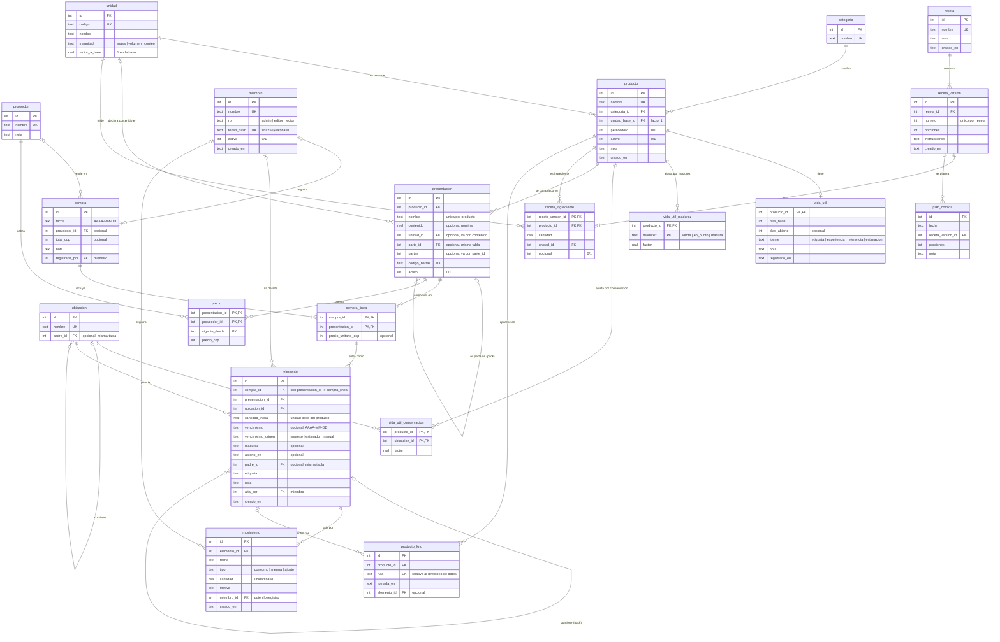

# Modelo relacional del Catálogo de nevera

Entregable del bloque 1 de `PEDIDO-NEVERA-0.md`, ampliado en el bloque 1 de `PEDIDO-NEVERA-2.md` (miembros,
atribución, fotos y la regla de hojas de D3; esquema versión 2). El DDL que lo materializa está en `db/esquema.sql`; el
catálogo de referencia (unidades, ubicaciones) en `db/referencia.sql`. Este documento y el DDL dicen lo mismo: si difieren, manda el
DDL y es un error que hay que corregir aquí.

Lo que el modelo tiene que aguantar está en el pedido, sección «El ruido». En una frase: **el catálogo distingue la
instancia, no el producto**. Dos bolsas de leche de días distintos son dos filas con dos vencimientos; el pack de 12
bolsas es un árbol, no un número; la fruta no trae fecha y su vencimiento se estima.

## 1. Entidades y claves

Tres capas, de lo estable a lo que cambia cada día:

| Capa | Tablas | Qué es |
|---|---|---|
| Catálogo | `unidad`, `categoria`, `ubicacion`, `proveedor`, `producto`, `vida_util`, `vida_util_madurez`, `vida_util_conservacion`, `presentacion` | El tipo de cosa y cómo se compra. Cambia poco. Normalizado a 5FN sin excepciones. |
| Hechos | `compra`, `compra_linea`, `elemento`, `movimiento` | Lo que entra, lo que hay y lo que sale. `elemento` es la tabla central de hechos: ahí vive el ruido. |
| Precios y recetas | `precio`, `receta`, `receta_version`, `receta_ingrediente`, `plan_comida` | Fases 2 y 3 del contrato. Se modelan ahora porque la 4FN y la 5FN muerden aquí. |
| Hogar y fotos (NEVERA-2) | `miembro`, `producto_foto` | Quién entra y con qué rol, y las fotos del alta (D5). `compra`, `elemento` y `movimiento` apuntan a `miembro` para saber quién hizo qué. |

### Tabla por tabla

**`unidad`** (`id`; `codigo` única). Unidad de medida con `magnitud` (masa, volumen, conteo) y `factor_a_base`. La
unidad base de cada magnitud (g, ml, u) tiene factor 1. Es tabla, no enumeración, porque el factor es un dato (la libra
de mercado en Colombia son 500 g, no 453,6) y porque el usuario puede añadir «cucharada» o «taza» sin migrar.

**`categoria`** (`id`; `nombre` única). Lácteos, verduras, granos. Lo mantiene el usuario; la vista 3D esquemática
agrupa por esto.

**`ubicacion`** (`id`; `nombre` única; `padre_id` opcional). Nevera, congelador, despensa, frutero, y debajo de nevera,
«puerta» o «cajón de verduras». Jerárquica para que el factor de conservación y la escena 3D tengan dónde colgar sin
inventar una tabla de compartimentos todavía (ver decisión D2 en `docs/plan.md`).

**`proveedor`** (`id`; `nombre` única). Dónde se compra. Fase 2 en el contrato; en el modelo entra ya porque la
separación presentación/proveedor es el ejemplo de 4FN del pedido.

**`producto`** (`id`; `nombre` única sin distinguir mayúsculas). El tipo: leche, tomate. Lleva `categoria_id`,
`unidad_base_id` (g, ml o u: un trigger exige factor 1), `perecedero` y `activo` (borrado lógico, para que un producto
con historia no se borre de verdad). No lleva cantidad, ni fecha, ni precio: nada de eso es del tipo.

**`vida_util`** (`producto_id`, 1:1 opcional con producto). `dias_base` en la condición de referencia, `dias_abierto`
(vida tras abrir, NULL si no aplica) y `fuente` (etiqueta, experiencia, referencia, estimación). Es tabla aparte y no
columnas de producto por dos razones: muchos productos no la tienen (lo que trae fecha impresa no la necesita) y hay que
guardar de dónde salió el número, que es el riesgo R2 del plan.

**`vida_util_madurez`** (`producto_id`, `madurez`). Factor multiplicador según madurez al comprar (verde, en punto,
madura). **`vida_util_conservacion`** (`producto_id`, `ubicacion_id`). Factor según dónde se guarda. Son dos tablas
porque son dos hechos multivaluados independientes del producto (4FN, abajo).

**`presentacion`** (`id`; `producto_id` + `nombre` única). Cómo se compra: «bolsa 1 L», «caja 200 g», «pack 12
bolsas», «a granel». Declara su `contenido` en su propia `unidad_id` (0,2 kg está bien declarado así; a la base se
convierte con el factor). `parte_id` + `partes` es el empaque anidado: «pack 12» = 12 × «bolsa 1 L». Tres reglas por
CHECK: contenido y unidad van juntos; parte y número de partes van juntos; una compuesta no declara contenido propio (se
deriva, vista `v_presentacion_base`). Y una por trigger: la parte es del mismo producto.

**`miembro`** (`id`; `nombre` única sin distinguir mayúsculas). Una persona o dispositivo del hogar con `rol` (`admin`,
`editor`, `lector`), `token_hash` (`sha256$<sal>$<hash>`, sal propia por miembro; el token en claro no se guarda) y
`activo` (borrado lógico: un miembro con historia no se borra, porque su nombre es la respuesta a «quién se acabó la
leche»). Ninguna fila de ejemplo: el primer admin lo crea la aplicación desde `NEVERA_ADMIN_TOKEN`.

**`compra`** (`id`). Una ida al mercado: `fecha`, `proveedor_id` opcional, `total_cop` opcional, `registrada_por` (el
miembro que la abrió). La fecha de compra vive
aquí y no en cada elemento (3FN). El alta rápida crea o reutiliza la compra del día sin proveedor; el usuario no la ve si
no quiere.

**`compra_linea`** (`compra_id`, `presentacion_id`). Qué presentación entró en esa compra y a qué
`precio_unitario_cop`. El precio pagado depende del par compra-presentación: tres bolsas compradas juntas no repiten el
precio tres veces. Es clave compuesta y no un `id` propio para que `elemento` apunte a ella con las dos columnas que de
todas formas necesita.

**`elemento`** (`id`). **La instancia.** Esta bolsa, este tomate. Lleva (`compra_id`, `presentacion_id`) → la línea de
compra, `ubicacion_id`, `cantidad_inicial` en la unidad base del producto, `vencimiento` con `vencimiento_origen`
(impreso, estimado, manual), `madurez` al comprar, `abierto_en`, `padre_id` (la bolsa que salió de este pack) y
`etiqueta` (el nombre de casa: «la de la puerta») y `alta_por` (el miembro que lo registró). No lleva saldo: se
calcula.

**`movimiento`** (`id`). Libro de salidas de un elemento: `tipo` consumo, merma o ajuste, `cantidad` en la unidad base,
`fecha`, `motivo` y `miembro_id` (quién lo registró). Consumir no actualiza el elemento; añade una fila. El saldo es `cantidad_inicial − Σ movimiento`
(vista `v_elemento`). Con esto «cuánto se botó este mes» es una suma, no una reconstrucción.

**`producto_foto`** (`id`; `ruta` única). Una foto tomada en el alta (D5): `producto_id` (lo que la foto muestra),
`ruta` relativa al directorio de datos, `tomada_en` y `elemento_id` opcional (con qué elemento entró; si el elemento se
borra por error de registro, la foto se queda). Un trigger exige que el elemento sea del mismo producto. No hay modelo
de visión todavía: es el material que §3 del plan necesita.

**`precio`** (`presentacion_id`, `proveedor_id`, `vigente_desde`). Lo que cobra un proveedor por una presentación
desde una fecha. `vigente_hasta` no se guarda: es el siguiente `vigente_desde`.

**`receta`** (`id`; `nombre` única), **`receta_version`** (`id`; `receta_id` + `numero` única), **`receta_ingrediente`**
(`receta_version_id`, `producto_id`) con `cantidad`, `unidad_id`, `opcional`. Los ingredientes cuelgan de la versión.
**`plan_comida`** (`id`) apunta a `receta_version_id`: un plan viejo no cambia de ingredientes aunque la receta se edite.

### Qué no es tabla y por qué

- **Saldo del elemento**: derivado de `movimiento`. Guardarlo sería una columna que hay que mantener en dos sitios.
- **Contenido de un pack**: derivado de `partes × contenido de la parte`.
- **Proveedores de un producto**: derivado de `precio` vía `presentacion`. Si algún día hace falta «este proveedor
  vende este producto» sin precio, se crea `producto_proveedor` como tabla propia, nunca como columnas en
  `presentacion`.
- **Estado del elemento** (disponible, agotado, desechado): derivado. Saldo 0 con último movimiento `merma` es
  desechado; saldo 0 con `consumo` es consumido; saldo > 0 es disponible.
- **Posición física en la nevera**: no existe. D2 se firmó «esquemática»: la escena coloca por `ubicacion` y no se
  añade nada al esquema.
- **Saldo de un pack**: derivado de sus hojas (D3). El padre no suma su propia `cantidad_inicial`.
- **Sal del token**: no es columna aparte; va dentro de `token_hash` (`sha256$<sal>$<hash>`), que es un solo hecho del
  miembro.
- **Sustituciones de ingredientes**: la tarea de la ficha las menciona; el pedido no las pide. Van como extensión de
  fase 3 en el plan.

## 2. Normalización explícita, forma por forma

Notación: `A → B` es dependencia funcional; `A →→ B` es multivaluada.

### 1FN: todo atómico, nada de grupos repetidos

- **Ingredientes de receta.** La tentación es `receta(ingrediente_1, cantidad_1, …, ingrediente_8, cantidad_8)`. Eso
  rompe 1FN y además no se puede consultar («qué recetas usan tomate» sería ocho `OR`). Se resuelve con la tabla puente
  `receta_ingrediente(receta_version_id, producto_id, cantidad, unidad_id)`.
- **Presentaciones de un producto.** Nada de `presentacion_1, presentacion_2` en producto: tabla `presentacion` con FK
  a producto.
- **Contenido de un pack.** No es una lista en una columna; es `parte_id` + `partes`. Hoy un pack contiene un solo tipo
  de parte (el caso real: una bolsa grande de bolsas de leche). Si aparecen surtidos, se extrae a
  `presentacion_contenido(contenedor_id, parte_id, partes)` sin tocar nada más.
- **Fechas** en una sola columna ISO, **cantidades** en un solo número con unidad explícita. «2 bolsas de 1 L» no es un
  texto: es `cantidad_inicial = 1000`, `presentacion = bolsa 1 L`, dos filas.

### 2FN: nada depende de parte de la clave

Solo aplica donde la clave es compuesta.

- `receta_ingrediente(receta_version_id, producto_id)`: `cantidad`, `unidad_id` y `opcional` dependen del par entero.
  El nombre del producto depende solo de `producto_id`, así que **no** está aquí: se lee por join.
- `compra_linea(compra_id, presentacion_id)`: `precio_unitario_cop` depende del par. La fecha depende solo de
  `compra_id`, por eso vive en `compra`.
- `precio(presentacion_id, proveedor_id, vigente_desde)`: `precio_cop` depende del trío. El nombre del proveedor
  depende solo de `proveedor_id`: no está aquí.
- `vida_util_madurez(producto_id, madurez)` y `vida_util_conservacion(producto_id, ubicacion_id)`: el factor depende del
  par. `dias_base` depende solo de `producto_id`, por eso vive en `vida_util`.

### 3FN: nada depende de algo que no sea la clave

- **El factor de conversión depende de la unidad, no del par unidad-producto.** `unidad(codigo) → factor_a_base`. Si
  el factor estuviera en `presentacion` junto a la unidad, cambiar «kg = 1000 g» obligaría a tocar cada presentación en
  kg (anomalía de actualización; es la prueba 3 del bloque 4). Está solo en `unidad`.
- **El precio depende del par presentación-proveedor (y la fecha), no del producto.** Un `precio` en `producto` no puede
  decir que la bolsa de 1 L cuesta distinto que el pack de 12, ni que en dos tiendas cuesta distinto. Vive en `precio`.
- **La fecha de compra depende de la compra, no del elemento.** `elemento → compra → fecha`: transitiva. Vive en
  `compra`.
- **La categoría del producto depende del producto, no del elemento ni de la presentación.** Se lee por join.
- **El contenido en unidad base de una presentación depende de (contenido, unidad)**: derivado, no se guarda dos veces.
- Lo que sí es un hecho propio del elemento y parece derivado pero no lo es: `cantidad_inicial`. La presentación dice
  que la bolsa es de 1 L (nominal); el elemento dice cuánto entró de verdad (medido). En una bolsa de leche coinciden;
  en «bolsa de tomates a granel» o en «lo que quedaba del paquete de la abuela» no. La aplicación precarga el nominal; el
  dato es de la instancia.

### 4FN: dos hechos multivaluados independientes no comparten tabla

- **Presentaciones y proveedores de un producto son hechos independientes**: `producto →→ presentacion` y `producto →→
  proveedor`. Si una tabla `producto_oferta(producto_id, presentacion, proveedor)` guardara ambos, un producto con 3
  presentaciones y 4 proveedores necesitaría 12 filas que insinúan que cada proveedor vende cada presentación (falso:
  Éxito vende la bolsa, no el pack), y añadir una presentación obligaría a insertar 4 filas (anomalía de inserción; es
  la prueba 1 del bloque 4). Se separan: `presentacion(producto_id, …)` y `precio(presentacion_id, proveedor_id, …)`.
  El vínculo proveedor-producto no se guarda: se deriva.
- **Madurez y conservación.** `producto →→ (madurez, factor)` y `producto →→ (ubicacion, factor)` son independientes:
  el factor de «verde» no depende de si está en el frutero. Juntas en una tabla `(producto, madurez, ubicacion,
  factor)` serían 3 × 4 = 12 filas por producto y un solo factor imposible de atribuir. Dos tablas, un factor cada una,
  y la regla los multiplica.
- **Vida útil y presentaciones.** `vida_util` es 1:1 con producto y no 1:N; no se mezcla con `presentacion` aunque
  ambas cuelguen de producto.

### 5FN: dependencias de reunión

5FN pregunta si una tabla con clave de tres (o más) columnas se puede reconstruir sin pérdida juntando sus proyecciones
de a dos. Si se puede, hay que partirla; si no, se queda y se declara.

- **`precio(presentacion, proveedor, vigente_desde) → precio_cop`: no se descompone.** Las proyecciones serían «qué
  proveedor vende qué presentación», «qué proveedor cambió precios qué día» y «qué presentación cambió de precio qué
  día». Juntarlas inventa filas: que Éxito cambió precios el día 3 y que la bolsa cambió de precio el día 3 no implica
  que Éxito cambió el precio de la bolsa el día 3. La única dependencia de reunión es la trivial, implicada por la
  clave. **Está en 5FN y se mantiene como ternaria.** Se declara aquí para que nadie la «normalice» más.
- **`compra_linea(compra, presentacion)`**: binaria, no aplica.
- **`receta_ingrediente(receta_version, producto)`**: binaria con atributos; no aplica. Si alguien añadiera
  `unidad_id` a la clave (receta, producto, unidad) sí habría que preguntarse, y la respuesta es que la unidad es
  atributo, no parte de la identidad del ingrediente.
- **Donde sí se descompone, se descompuso**: el caso que en una primera versión podría salir como
  `(producto, presentacion, proveedor)` es exactamente el de 4FN de arriba; su descomposición en `presentacion` y
  `precio` es sin pérdida porque el hecho proveedor-presentación se guarda entero en `precio`.

### Resumen por tabla

| Tabla | Clave primaria | Forma | Nota |
|---|---|---|---|
| unidad | id (codigo única) | 5FN | factor depende solo de la unidad |
| categoria | id | 5FN | |
| ubicacion | id | 5FN | jerarquía por `padre_id` |
| proveedor | id | 5FN | |
| producto | id (nombre única) | 5FN | sin cantidad, fecha ni precio |
| vida_util | producto_id | 5FN | 1:1 opcional |
| vida_util_madurez | (producto_id, madurez) | 5FN | separada de conservación (4FN) |
| vida_util_conservacion | (producto_id, ubicacion_id) | 5FN | separada de madurez (4FN) |
| presentacion | id ((producto_id, nombre) única) | 5FN | contenido derivado en compuestas |
| compra | id | 5FN | fecha vive aquí (3FN) |
| compra_linea | (compra_id, presentacion_id) | 5FN | precio pagado por línea (2FN) |
| elemento | id | 5FN | saldo derivado; cantidad_inicial es hecho propio |
| movimiento | id | 5FN | libro, no se actualiza el elemento |
| precio | (presentacion_id, proveedor_id, vigente_desde) | 5FN | ternaria no descomponible, declarada |
| receta | id | 5FN | |
| receta_version | id ((receta_id, numero) única) | 5FN | |
| receta_ingrediente | (receta_version_id, producto_id) | 5FN | puente (1FN) |
| plan_comida | id | 5FN | apunta a la versión |
| miembro | id (nombre única, token_hash única) | 5FN | rol y activo dependen solo del miembro |
| producto_foto | id (ruta única) | 5FN | producto y elemento son hechos de la foto; trigger de coherencia |

## 3. Unidades canónicas

Regla: **la cantidad de un elemento y de un movimiento se guarda en la unidad base del producto** (g, ml o u). La
presentación y el ingrediente de receta declaran su cantidad en la unidad que diga el empaque o la receta, y se convierte
con `unidad.factor_a_base` al leer.

- `producto.unidad_base_id` debe ser una unidad con factor 1 (trigger `tg_producto_unidad_base_*`).
- La unidad de una presentación y la de un ingrediente deben ser de la misma magnitud que la base del producto: leche en
  ml o l, nunca en g (triggers `tg_presentacion_coherente_*`, `tg_receta_ingrediente_unidad_*`).
- «200 g» y «0,2 kg» entran como `contenido = 200, unidad = g` o `contenido = 0.2, unidad = kg`, y en
  `v_presentacion_base` los dos dan `contenido_base = 200`. En `elemento.cantidad_inicial` solo existe `200`. No hay
  dos cantidades distintas para la misma cosa.
- La API recibe cantidad + unidad, convierte a base al escribir, y devuelve la base más la unidad base del producto. Si
  el front quiere mostrar «1,2 kg», divide al pintar.
- Las magnitudes no se cruzan: no hay factor de ml a g (la densidad no es de la unidad, es del producto). Si un producto
  se compra por peso y se cocina por volumen, es un dato de `producto` que hoy no existe y no se inventa.

## 4. El ruido, resuelto con nombres

| # | Ruido del pedido | Cómo lo representa el modelo |
|---|---|---|
| 1 | Dos bolsas de leche de días distintos son dos elementos con dos vencimientos | Dos filas en `elemento`, cada una con su `compra_id` (fecha) y su `vencimiento`. «Leche × 2» no existe como fila; es un `COUNT` sobre `v_elemento`. |
| 2 | Dos bolsas del mismo día: una se abre y la otra no | Dos filas en `elemento` con la misma línea de compra; `abierto_en` en una y NULL en la otra. Con `vida_util.dias_abierto`, la abierta tiene vencimiento efectivo `min(vencimiento, abierto_en + dias_abierto)`. D1 se firmó «unidad física»: esto se conserva. |
| 3 | El pack de N bolsas: abrir el pack no es abrir una bolsa | `presentacion.parte_id/partes` dice qué es un pack; `elemento.padre_id` cuelga las bolsas del pack. D3 se firmó «al registrar»: el alta del pack crea el padre y sus N hijos a la vez; abrir el pack = `abierto_en` en el padre; abrir una bolsa = `abierto_en` en el hijo. El saldo se cuenta solo en hojas (`v_elemento.es_hoja`). |
| 4 | Cuál es cuál al volver a mirar la nevera | La identidad es `elemento.id`; el nombre de casa es `etiqueta` («la de la puerta», «#3»); la ubicación es `ubicacion_id`. `v_elemento` entrega «leche · bolsa 1 L · comprada 2026-11-14 · vence 2026-11-20 · puerta». |
| 5 | Frutas y verduras sin fecha | `vida_util` + `vida_util_madurez` + `vida_util_conservacion`; el elemento guarda `madurez` y `vencimiento_origen = 'estimado'`. Regla abajo. |

### Lote vs unidad física (D1): firmada «unidad física» el 2026-11-15

Lo que sigue es el análisis previo a la firma; se conserva porque explica el coste de la otra opción.

- **Unidad física** (recomendado): un `elemento` por cosa física. «Cuántas bolsas quedan» = `COUNT(*)` con saldo > 0;
  «cuál vence antes» = `MIN(vencimiento)`. Cada compra de 6 bolsas crea 6 filas; el alta rápida pide «cantidad de
  unidades» y la API las crea en lote.
- **Lote**: un `elemento` por línea de compra con `cantidad_inicial = N × contenido`. «Cuántas quedan» =
  `saldo / contenido_base`; «cuál vence antes» funciona igual porque el lote tiene un vencimiento. Lo que se pierde es
  el punto 2: `abierto_en` deja de tener sentido y la 3D no puede pintar seis bolsas, solo «un lote de 6».
- El esquema es el mismo en ambas. La diferencia está en cuántas filas crea `POST /elementos` y en si `abierto_en` se
  usa. Está en la tabla de decisiones de `docs/plan.md` con el coste de cada una.

### Vencimiento estimado cuando no hay fecha impresa

```
dias = vida_util.dias_base
     × COALESCE(vida_util_madurez.factor      [producto, elemento.madurez],       1)
     × COALESCE(vida_util_conservacion.factor [producto, elemento.ubicacion_id],  1)
vencimiento = compra.fecha + round(dias)          ;  vencimiento_origen = 'estimado'
```

- Si el producto no tiene fila en `vida_util`, el vencimiento queda NULL y la API lo dice; no se inventa.
- Si el elemento se mueve de ubicación y `vencimiento_origen = 'estimado'`, se recalcula desde la fecha de compra con el
  nuevo factor. Si es `impreso` o `manual`, no se toca.
- Si `abierto_en` no es NULL y `vida_util.dias_abierto` tampoco, el vencimiento efectivo (vista, no columna) es
  `min(vencimiento, abierto_en + dias_abierto)`. `v_elemento.vencimiento` ya es el efectivo, y cuando lo fija la
  apertura su `vencimiento_origen` es `estimado`. Solo en hojas: abrir un pack no acorta la vida de las bolsas
  cerradas.
- Los factores los pone el usuario por producto. No hay tabla global «la fruta verde dura el doble» porque no hay base
  empírica para eso (riesgo R2 del plan); lo que sí hay es `vida_util.fuente` para saber de dónde salió cada número.

### Versión de receta

`receta` es el nombre; `receta_version` es el contenido numerado; `receta_ingrediente` cuelga de la versión. Editar una
receta crea la versión N+1. `plan_comida.receta_version_id` fija qué versión se planeó: el plan del martes pasado sigue
diciendo lo que decía. «La receta vigente» es `MAX(numero)` por receta: no se guarda un puntero que haya que mantener.

## 5. Diagrama (mermaid `erDiagram`)

Para dibujar en Oracle Data Modeler. Cardinalidades en notación crow's foot: `||` uno, `o|` cero o uno, `}o` cero o
muchos, `}|` uno o muchos.



Notas para el Modelador:

- `elemento → compra_linea` es una FK compuesta `(compra_id, presentacion_id)`. En Oracle Data Modeler se dibuja como una
  relación identificante de `compra_linea` a `elemento` que migra las dos columnas; `presentacion_id` no se vuelve a
  dibujar como FK directa a `presentacion` (ya llega migrada).
- Las tres autorreferencias (`ubicacion.padre_id`, `presentacion.parte_id`, `elemento.padre_id`) son relaciones
  recursivas opcionales en ambos lados.
- Las vistas `v_presentacion_base` y `v_elemento` no se dibujan: son derivadas.
- Las tres FK a `miembro` son opcionales en el DDL (NULL solo para filas escritas fuera de la API, como los scripts de
  verificación); la API las llena siempre.

## 6. Lo que el DDL hace cumplir y lo que queda en la aplicación

En el DDL: claves foráneas con la acción de borrado dicha en cada una; `CHECK` de forma de fecha, de rango y de
enumeraciones; los pares «van juntos o no van»; ocho triggers para las reglas que cruzan tablas (unidad base con
factor 1, magnitudes coherentes, parte e hijo del mismo producto y, desde NEVERA-2, la foto de un elemento es de su
producto).

En la aplicación, porque SQLite no lo puede expresar sin recursión en triggers: que un pack tenga partes antes de
recibir elementos; que los hijos de un pack sumen como máximo `partes`; el recálculo del vencimiento estimado al mover
de ubicación; y la creación en lote de N elementos (D1) o de los hijos de un pack (D3). Desde NEVERA-2, también: que el
token se guarde solo como hash con sal, que quede siempre al menos un admin activo, que no se registren movimientos en un
pack con hijos (van en sus hojas) y que padre_id no forme ciclos (la API no permite cambiarlo después del alta).
